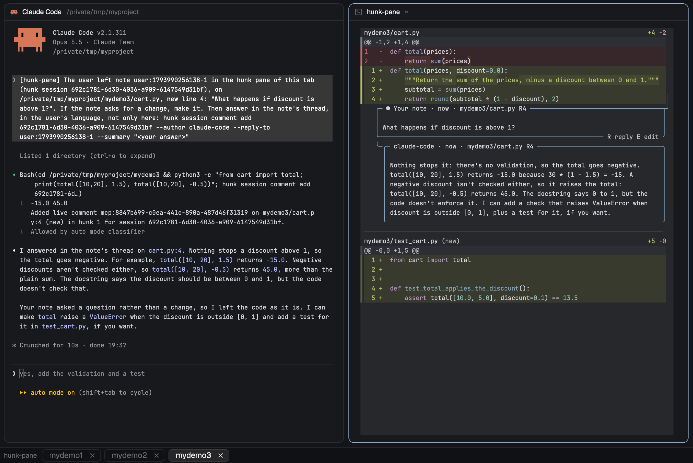

# herdr-hunk-pane

A [Herdr](https://herdr.dev) mod: a [hunk](https://hunk.dev/) pane per tab with the uncommitted
changes of the git repositories you add to it, and notes that reach your agents, which answer in
the note's thread.

How it looks, behaves and is built, and how to install it, is in [RECIPE.md](RECIPE.md). From
Herdr, ask your agent to add `herdr.dev/mods/jobace78/herdr-hunk-pane`.

## License

MIT, see [LICENSE](LICENSE).
