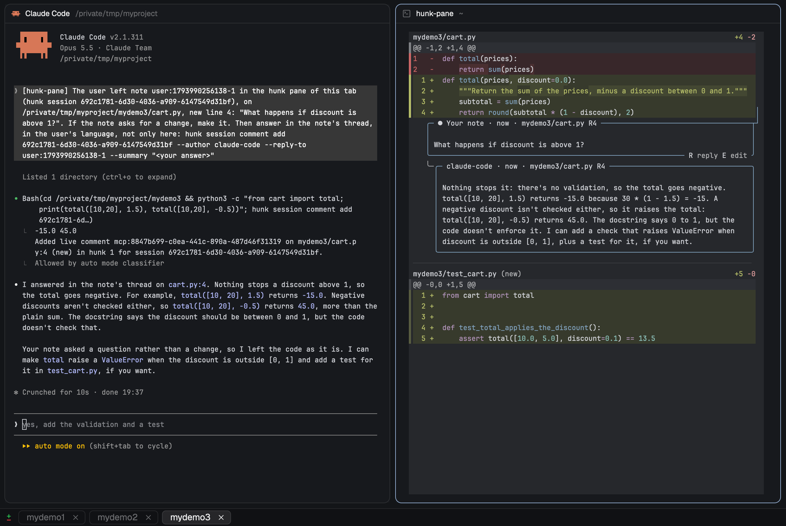

# Hunk Pane

A [hunk](https://hunk.dev/) pane in the current tab with the uncommitted
changes of the git repositories you add to it, one at a time, and a thin strip
under the panes with one button per repository to switch between them. You add
a repository from any terminal of the tab with `! hunk-pane [path]` (in Claude
Code or Codex; plain `hunk-pane` in a shell); the pane opens beside your work
without taking the focus and reloads as the files change. A note you write in
the pane goes to the agent that added its repository, which answers in the
note's thread.



## What you see

- **The strip**: 28 px tall, the full width of the work column, right under the
  panes (not under the sidebar). Background `chrome`, a 1 px `border` line on
  top, 8 px of padding on both sides so its content lines up with the pane cards
  above, 14 px text. It always starts with a 14 px ± icon, the + green and the
  − red, with a `hunk-pane` tooltip.
- **No pane in the focused tab**: the icon alone.
- **With a pane**: after the icon, one button per repository added, framed
  like the tabs: 22 px tall, a 1 px `border` outline rounded 6 px, 12 px padding
  on the left and 5 px on the right, 7 px between the name and its ×, 6 px
  between buttons. The shown repository's button is pressed (`selected`
  background, `foreground` text); the others have the `chrome` background and
  `dim` text. The × is a 13 px icon in a 3 px padded, 4 px rounded hit area.
  Buttons are sorted by name, then path; a name is the repository's folder name,
  or `<parent>-<folder>` when the pane has that one already (`work-api`), then a
  number (`work-api-2`). Too many buttons scroll sideways. When the shown
  repository cannot be written for the pane, `'<name>' repository could NOT be
  shown (exit <code>)` follows the buttons, whole, in 12 px `dim` text until it
  can (1: the patch file, 3: git could not read the repository, 4: over 8 MiB,
  most likely a log to ignore; `(did not run)`: `patch.py` could not start or
  ran past 30 s). In the same place, `hunk notes could NOT be read (…)` says
  notes stopped reaching the agents.
- **The pane**: a regular Herdr pane in the tab, titled `hunk-pane`, running
  hunk. It shows the shown repository's uncommitted changes against its last
  commit (everything, before the first one), untracked files included but not
  nested repositories, a submodule as the commit it points to, each path under
  the repository's name.

## How it behaves

- **Adding**: `hunk-pane [path]` takes the repository the path is in, or the
  current folder's, and makes it the shown one: it opens a pane in the tab of
  the terminal it ran in, without moving the focus, or joins the pane the tab
  has. A repository already there is just shown, and its notes go from then on
  to the terminal the command ran in (that is how another agent takes them
  over). One with no uncommitted changes is added too: hunk shows "No changes
  to review." until it has some. Outside Herdr, outside a repository, as root,
  without `hunk` on the `PATH` for a new pane, or when Herdr cannot tell it the
  tab or the pane, or will not open or label the pane, it fails.
- **Clicking a button** shows that repository: the pane switches within a
  moment. Clicking the pressed one does nothing.
- **The ×** takes a repository out. If it was the shown one, the next button
  is shown (the previous one when it was the last). Taking out the last
  repository closes the pane, and hunk with it.
- **Hover**: a button gets the `hover` background and `foreground` text; the ×
  gets the `raised` background.
- **Refresh**: every 3 s the strip rewrites the focused tab's patch, and right
  away after a click or a tab switch; the panes of other tabs wait until their
  tab is shown. The patch file is replaced only when its content changes, so
  hunk reloads only then, and keeps its scroll position.
- **Notes**: a note you write in the pane goes, once, to the agent of the
  terminal that added its repository last: a one-line message with the real file
  path, the line and your text, asking it to make any change the note asks for
  and to answer in the note's thread, where the answer then shows. A note waits
  for a later refresh while that agent is working or blocked, or when the
  repository was added from a terminal with no agent. A note you edit goes
  again, as an edit ("The user edited note …").
- **Tabs**: the strip always shows the focused tab's pane. Each tab has its own
  pane and its own set of repositories.
- **Closing** the pane with its × ends hunk; its terminal is removed and the
  strip deletes the patch, and the private indexes beside it, within two
  refreshes.
- **Agent statuses**: the strip shows none; they only decide when a note is
  sent.
- **Keys**: none.

## Built from

- **Layout**: one block in the `work` column, right after `work-body` (in a
  clone of Herdr's `main` layout, before its `status` bar):

  ```json
  { "content": { "mod": "hunk-pane" }, "id": "hunk-pane", "size": { "px": 28 }, "type": "block" }
  ```

- **`mods/hunk-pane/mod.json`**: `{ "place": "none", "title": "Hunk Pane" }`.
  `place` is `none` because a docked mod (`"bottom"`) goes under the whole
  window, sidebar included, not under the panes.
- **`mods/hunk-pane/main.js`**, the strip: a `View` whose `render()` reads
  `focused().tab` and `terminals()`, and draws with `h_flex`, `div`, `image`,
  `svg` and `theme()`. A `cx.timer.every(3000)` refresh runs `python3
  <appHome>/mods/hunk-pane/patch.py <patch> <name> <repo>` through `exec` inside
  `cx.spawn`, lists `~/.cache/hunk-pane/` with `fs.readdir` and deletes the
  files of panes gone with `rm -f`. Clicks call `hc(["label", …])`; the last ×
  closes its pane, found in `panes()`, with `run("pane.close", { pane })`. The
  same refresh reads each pane's user notes from `hunk session list --json` (the
  session whose `sourceLabel` is the patch path, its
  `snapshot.state.reviewNotes` whose `source` is `user`) and sends each new one
  with `hc(["send", agent, message])` to the `agents()` entry whose address is
  the repository's `from`. The notes sent are kept in `localStorage` per hunk
  terminal and note version, so a reload sends none twice and an edit goes
  again, and dropped when that terminal closes, not when hunk stops listing its
  session (it lists none while its daemon is down).
- **`mods/hunk-pane/helpers.js`**: the decisions that need no Herdr (the
  repositories from the labels, what a × changes, where a note goes and its
  message), imported by `main.js`. Herdr's modules only exist inside Herdr, so
  this is the file `node --test` can load.
- **`mods/hunk-pane/patch.py`**: writes one patch for one repository (or an
  empty one), against `HEAD` (the empty tree before the first commit) with paths
  as `a/<repo name>/<path>`, replacing the file only when the patch changed. It
  diffs through a private copy of the repository's index,
  `~/.cache/hunk-pane/<tab id>.<md5>.index`, refreshed with `update-index
  --refresh` only when that index changes. Python 3.9 standard library only, 4 s
  timeout per git call, so that its at most seven calls end within the 30 s
  Herdr gives `exec`; a patch over 8 MiB is written empty.
- **`mods/hunk-pane/hunk_pane.py`**: the command, in the mod folder so that
  copying the mod installs and updates it too, linked onto your `PATH` as
  `hunk-pane` from that copy (for example `ln -s
  ~/.config/herdr-app/mods/hunk-pane/hunk_pane.py ~/.local/bin/hunk-pane`;
  `chmod +x` it if the copy lost the bit). It reads its terminal's tab from `hc
  get $HC_TERMINAL_ID --json` (labels `herdr.space`, `herdr.tab`), finds the
  tab's pane with `hc ls --json --label hunk-pane.tab=<tab>`, and labels it, or
  starts one with `hc run --bg --no-parent --rm --cwd ~` and the labels
  `herdr.space` and `herdr.tab` (Herdr adopts it as a pane of that tab, without
  the focus), `hunk-pane.tab` and the repository's, its name chosen against the
  names the pane already holds. That terminal runs `hunk patch <patch> --watch`
  on `~/.cache/hunk-pane/<tab id>.patch`, touched first so hunk has a file to
  open. It exits 1 on the failures listed in Adding, else 0.
- **The protocol** is the hunk terminal's labels, written by both sides (only
  here: the script and `main.js` point to this list):

  ```
  hunk-pane.from.<md5>=<terminal>  the terminal that added the repository last, whose agent gets its notes
  hunk-pane.name.<md5>=<name>      the repository's button, and its folder in the patch
  hunk-pane.repo.<md5>=<repo>      one per repository added, keyed by the md5 of its path
  hunk-pane.selected=<repo>        the repository shown
  hunk-pane.tab=<tab id>           its tab; the patch is ~/.cache/hunk-pane/<tab id>.patch
  ```

- **Programs**: `hunk` (tested with 0.25.0), `git` 2.31 or newer (`rev-parse
  --path-format`), `python3` 3.9 or newer (the one macOS ships in
  `/usr/bin/python3` is enough), `hc` (Herdr's), `sh` and `rm`. Tested with
  Herdr 0.1.15.
- **Art**: `close.svg`, a copy of Herdr's `mods/pane/close.svg`, so the × looks
  like the panes' own; `hunk_pane.svg`, the ± drawn with `image`, since `svg`
  draws in the text color alone.

## Watch out

- **Platforms**: tested on macOS only. Linux should work but has not been run;
  Windows does not (the script starts hunk through `sh -c`, the strip runs `rm`
  and `python3`). The patches always go to `~/.cache/hunk-pane/`, whatever
  `XDG_CACHE_HOME` says: the script and the strip run with different
  environments and must agree, and the strip never takes the patch path from a
  terminal, whose labels and argv any process can set.
- **Install both halves**: the mod folder in `mods/`, the layout block in a
  layout of your own, and the copied `hunk_pane.py` on the `PATH` as
  `hunk-pane`. Without the block nothing shows: the mod never docks itself.
  Herdr's own layouts are read-only, and an edit to one is moved aside on the
  next start, so clone `main` first (`herdr-app do layout.clone
  '{"name":"main","as":"my-layout"}'`) and add the block to the clone.
  Copy the mod folder, never link it: through a symlinked folder Herdr runs the
  code but loads no art, so the × is missing. After updating this folder, copy
  the mod folder into `mods/` again: Herdr and the linked `hunk-pane` both run
  that copy.
- **It runs programs**: the strip runs `python3`, `rm` and `hunk session` and
  calls `hc`, which types notes into agents; the script runs `git`, `hc` and
  `hunk`. Neither reaches the network itself (git may, in a partial clone, as in
  your shell). Files are written only in `~/.cache/hunk-pane/`, and in a
  temporary folder (a copy of a repository's index, deleted after each diff).
- **One hunk per tab, not one per repository**: `terminal.show` lasts only until
  the next tab switch, and adopting and parking terminals moves and resizes the
  pane, so per-repository hunks cannot swap in place; `hunk session reload
  --source` cannot switch repositories either. One hunk watches one patch, which
  the strip rewrites.
- **Labels are open to any process**, and the tab id names a file: both sides
  ignore a `hunk-pane.tab` that is not `[A-Za-z0-9_-]+`.
- **A new pane's patch** exists a moment before its terminal does, so a patch
  is deleted only after two refreshes in a row without a pane.
- **git runs as in your shell**: the repository's config applies, as it does for
  the agents' git; whoever can write it can already run any program, so the
  strip is not hardened against it. Only the output is pinned to the plain diff
  hunk reads (`--no-color`, `--no-ext-diff`, `--no-textconv`, `--no-renames`,
  `--submodule=short`). The repository's index and objects are never changed
  (`--no-optional-locks`): untracked files enter a temporary copy of the index,
  copied with its mtime (racy git), with the empty blob's id (`update-index
  --index-info`); `add --intent-to-add` would rewrite that blob, and touch its
  whole pack, on every refresh.
- **A stale index is refreshed privately**: the index's stat data goes stale
  after a checkout, and for good in a folder another machine syncs (Dropbox), so
  git would hash every file again on each refresh. `patch.py` diffs through a
  copy per repository beside the patch, refreshed only when the repository's
  index changes and given its mtime (to tell when, and for racy git). That one
  refresh can still pass the 4 s limit in a large repository and show `(exit
  3)`; a plain `git status` there ends it.
- **The script needs `HC_TERMINAL_ID`**, which Herdr sets in its terminals and
  the `!` commands of Claude Code and Codex inherit (Codex only with its default
  `shell_environment_policy`, `inherit = "all"`). The hunk terminal gets neither
  it nor `HC_SCOPE`, and `--no-parent`, so it outlives the program that ran the
  script and is not taken for a sub-agent.
- **hunk sets no terminal title**: the script starts it through `sh -c` with an
  OSC 2 `hunk-pane` title first, or the pane header would show the terminal
  address.
- **`fs/promises` in a mod has no `stat`**: use `readdir`. An exception inside
  `cx.spawn` would leave the refresh's busy flag set forever: keep it in a
  `try`/`finally`.
- **`herdr-app check`** renders the mod once; it does not catch errors that
  happen later, in the refresh or on a click.
- **The strip's log is out of sight**: what `patch.py` and `hunk session list`
  print goes to the mod's `console.log`, which Herdr started from the Dock sends
  nowhere. To see why a repository shows `(exit 3)`, run the same command in a
  terminal: `python3 ~/.config/herdr-app/mods/hunk-pane/patch.py
  /tmp/check.patch <name> <repository>`; for `hunk notes could NOT be read`,
  `hunk session list --json`.
- **Notes are typed into an agent**: only into a terminal `agents()` lists,
  never a blocked one (`hc send` refuses it, so a note cannot answer a dialog),
  as one line, since `hc send` submits it with Enter. `hc send` waits for you to
  pause, so a note can land in the shell under an agent you quit meanwhile: its
  double quotes and backquotes become `'` and its `$(` becomes `$ (`, so that
  shell runs nothing from it.
- **A note's path is the patch's** (`<repo name>/<path>`): the strip maps it
  back through its first folder. So a name has no slash, is unique in the pane
  and never changes nor passes to another repository while the pane lives, or a
  waiting note would reach the wrong one; a note on a repository taken out is
  not sent.
- **Notes live in the running hunk**: closing the pane loses them.
- **Notes sent are remembered per Herdr window**, in the mod's `localStorage`: a
  reload of the mod or a layout switch sends none twice, but two Herdr clients
  showing the same tabs would each send every note.
- **A reboot loses the pane's hunk**: hc brings a pane's terminal back as a
  login shell, with the same address and labels but another `argv`. The strip
  closes a hunk-pane terminal whose `argv` does not name its patch, and the
  script does not take it for the pane, so `! hunk-pane` opens a new one.
- **The notes come from an undocumented field**, `snapshot.state.reviewNotes` in
  `hunk session list --json` (hunk 0.24.1): one call for every pane. If a hunk
  release changes it, or the call fails, the strip says `hunk notes could NOT be
  read (…)`; a hunk daemon that is down just lists no sessions.
- **The 8 px padding** matches the `work-body` padding of Herdr's `main`
  layout. With another padding there, change `.px(8)` in `main.js` so the
  buttons line up with the panes.

## Done when

- The tests in `tests/` pass: `node --test tests/`, and pytest 8.4 (the last
  release on Python 3.9) on Python 3.9 for the two scripts.
- `herdr-app check mods/hunk-pane` passes and the strip shows under the panes,
  with only its icon, in a tab with no pane.
- `! hunk-pane` in a repository with changes opens a `hunk` pane in that tab,
  the focus stays where it was, the strip shows one pressed button with the
  repository's name, and the pane lists its changes, untracked files included.
  In a repository with no changes it adds the button too, and the pane shows
  "No changes to review." until the first change.
- Adding a second repository adds a button in name order, pressed, and the
  pane shows that repository; clicking the first button shows the first again
  within a moment. One with the same folder name shows `<parent>-<folder>`.
- Saving a file in the shown repository updates the pane within 3 s without
  losing the scroll position.
- The × on the shown button shows the next repository; the × on the last button
  closes the pane, `hc ls` no longer lists its terminal, and its patch and
  private indexes are gone from `~/.cache/hunk-pane/` within 6 s.
- Switching tabs switches the strip to that tab's buttons, or to the icon
  alone, and that tab's pane shows its current changes at once.
- A note written in the pane reaches the agent that added its repository as one
  message, once (reloading the mod does not send it again), and the agent's
  `hunk session comment add --reply-to` answer shows in the note's thread.
